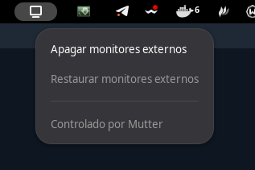

# Apagar Monitores

Extensión de GNOME Shell para apagar y restaurar monitores externos desde el
panel, también en Wayland. La configuración de pantalla se aplica mediante la
interfaz de Mutter `DisplayConfig`.

## Captura de la extensión



## Licencia

Este proyecto se distribuye bajo la licencia GPL-2.0-or-later. Consulta el
archivo [`LICENSE`](./LICENSE).

## Funciones

- Apaga los monitores externos activos y mantiene encendida la pantalla
  integrada.
- Permite restaurar la disposición original desde el mismo menú.
- Muestra notificaciones si no se puede consultar, aplicar o restaurar la
  configuración.

La opción de restaurar está disponible después de apagar los monitores y
mientras la extensión siga activa. Si vas a desactivarla o reiniciar GNOME
Shell, restaura primero las pantallas.

## Requisitos

- GNOME Shell 45, 46, 47, 51 o 51.1, según las versiones declaradas en
  [`metadata.json`](./metadata.json).
- Una pantalla integrada que Mutter identifique como tal.

## Instalación

Clona el repositorio en el directorio correspondiente al UUID de la extensión:

```sh
git clone https://github.com/jpupo91/apagar-monitores.git \
  ~/.local/share/gnome-shell/extensions/apagar-monitores@jpupo91
```

Después, cierra sesión y vuelve a entrar si es necesario, y habilita la
extensión:

```sh
gnome-extensions enable apagar-monitores@jpupo91
```

También puedes habilitarla desde la aplicación **Extensiones** de GNOME.

## Preparar el paquete para extensions.gnome.org

Desde la carpeta del proyecto, genera el archivo ZIP que se sube en
[extensions.gnome.org/upload](https://extensions.gnome.org/upload/):

```sh
gnome-extensions pack --force --extra-source=README.md --extra-source=LICENSE .
```

El comando crea `apagar-monitores@jpupo91.shell-extension.zip`. Inicia sesión en
la página de subida, carga el ZIP y sigue el proceso de revisión.

## Uso

1. Abre el icono de la extensión en el panel superior.
2. Selecciona **Apagar monitores externos**.
3. Para volver a la disposición anterior, abre el menú y selecciona
   **Restaurar monitores externos**.

La configuración original se conserva temporalmente mientras la extensión está
activa; no se guarda entre reinicios de GNOME Shell.
